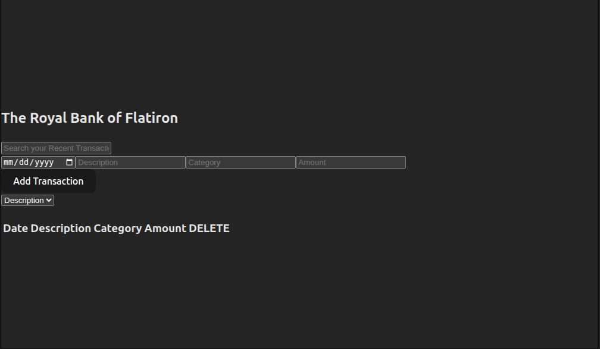

# Flatiron Bank — Transaction Tracker & Vitest Suite

A React banking application for viewing, adding, and searching financial transactions, accompanied by an automated test suite built with Vitest and React Testing Library.

## Screenshot



## Features & Test Coverage

- **Display Transactions (`GET`):** Fetches and renders initial transaction records on startup, verified via mocked `fetch` responses in Vitest.
- **Add New Transactions (`POST`):** Submits new transactions through a controlled form, updates the UI immediately, and verifies `POST` request execution in unit tests.
- **Search & Filter Transactions:** Filters displayed transactions dynamically by description as the user types in the search bar, backed by automated DOM event tests.

## Technologies Used

- React (`useState`, `useEffect`)
- Vitest & React Testing Library (`@testing-library/react`, `@testing-library/jest-dom`)
- Vite
- JSON Server (REST API)

## Getting Started

### Prerequisites

- Node.js and npm installed on your machine.

### Installation & Local Setup

1. Clone the repository:
   ```bash
   git clone https://github.com<your-vitest-lab-repo-name>.git
   ```
2. Navigate to the project directory:
   ```bash
   cd <your-vitest-lab-repo-name>
   ```
3. Install dependencies:
   ```bash
   npm install
   ```
4. Start the JSON server backend:
   ```bash
   npm run server
   ```
5. In a separate terminal, start the React development server:
   ```bash
   npm run dev
   ```

### Running the Test Suite

To execute the Vitest unit and integration tests:

```bash
npm run test
```
